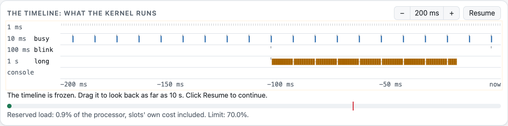
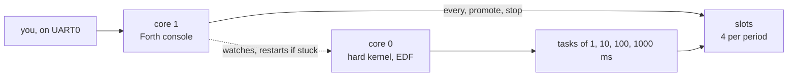

<p align="center">
  <picture>
    <source media="(prefers-color-scheme: dark)" srcset="docs/images/banner-dark.svg">
    
  </picture>
</p>

<p align="center">
  <a href="https://github.com/beber007/escapement-forth/actions/workflows/build.yml"></a>
  <a href="https://github.com/beber007/escapement-forth/actions/workflows/pages.yml"></a>
  
  
  
  
  <a href="LICENSE"></a>
</p>

<p align="center">
  <a href="https://beber007.github.io/escapement-forth/"><b>Try it in your browser</b></a> ·
  <a href="https://youtu.be/3fMFzSJFBvo">Demo video</a> ·
  <a href="#how-it-works">How it works</a> ·
  <a href="#limits">Limits</a> ·
  <a href="#building">Building</a> ·
  <a href="https://github.com/beber007/escapement">Escapement</a>
</p>

A Forth console for the [Escapement](https://github.com/beber007/escapement) real-time
kernel, on a Raspberry Pi Pico. You type a word and attach it to one of the periodic
tasks created before the kernel started, while the kernel keeps running.

A word attached with `every` runs on the next release of its task, with no rebuild and no
restart. A new word is timed on trial. `promote` then reserves it a share of the
processor, or refuses. A word that runs too long is cut off. A word that loops forever
does not stop the others.

This is a prototype: step 3 of [Escapement's issue #40](https://github.com/beber007/escapement/issues/40).

[](https://youtu.be/3fMFzSJFBvo)

<sub>[Watch the demo](https://youtu.be/3fMFzSJFBvo) (2 min), or [in French](https://youtu.be/f03H2mjgLlU). It runs on the web page, which uses the same Forth, slots and kernel as the board.</sub>

## Figures

| | |
|---|---|
| Pico image | 26,024 bytes of code and constants (Forth, slots, console, kernel), and 20,992 bytes of RAM reserved at build time. GCC 16.2, 2026-10-31 |
| Slots' own cost | 8 µs charged to each release, against 6.6 to 7.3 µs measured on the Pico ([issue #40](https://github.com/beber007/escapement/issues/40), step 1) |
| Budget check | About 13 % at most, on an empty `do loop`: 1,000 turns took 466 µs at the console and 529 µs in a slot (Pico W, 2026-10-24; the two cores' work was not quite the same) |
| Restart of core 0 | 3 to 4 ms for core 1 to notice that core 0 is stuck and restart it, keeping the dictionary, the slots and the console; 5 ms more if interrupts are masked or the core faulted |

## The timeline

<picture>
  <source media="(prefers-color-scheme: dark)" srcset="docs/images/timeline-dark.png">
  
</picture>

<sub>A capture of the [web page](https://beber007.github.io/escapement-forth/). `long` takes 80 ms once a second. `busy` takes 0.5 ms every 10 ms. Under EDF the kernel runs the earliest deadline first, so `long` runs in pieces and `busy` keeps its rhythm.</sub>

## How it works

The Pico has two cores:



- **Core 0** runs Escapement's hard kernel (EDF) and the slots (`src/slots.c`). There is
  one task per period, 1, 10, 100 and 1000 ms, and each task has four slots.
- **Core 1** runs the console: a small indirect-threaded Forth (`src/forth.c`) on UART0
  (GP0 TX, GP1 RX, 115200 8N1). It has no kernel. An interrupt every millisecond watches
  core 0 and reads the UART. Ctrl-C stops the running word, or clears the line.

```forth
\ board words: output high low toggle pins ( masks: 1 15 lshift is GP15 )
\ ms overruns restarts starts dropped fault ( fault: a HardFault, to test the restart )
variable n
: tick  1 n +! ;
' tick 10 every      \ slot 4, on trial: runs every 10 ms, its time is measured
slots                \ for each slot: runs, longest run
4 promote            \ guaranteed if it passes both limits below
4 stop
```

### Trial, then promotion

A new word is on trial. It runs and its time is measured, but nothing is guaranteed.

`promote` guarantees it, once the word has run ten times and never over budget. Its worst case becomes the longest run measured, plus a quarter,
plus 1 µs. The promotion is refused if all promoted words, plus the slots' own cost,
would take more than 70 % of the processor. That cost is 8 µs per release (6.6 to 7.3 µs
measured on the Pico, issue #40 step 1).

Words on trial count too. Each one takes its budget, a tenth of its period. All the
budgets, plus the slots' own cost, must fit in 95 % of the processor. Past that, `every`
says `processor full` and `promote` says `refused, with trials`. `slots` shows this total.

So nine words on trial at most, whatever their periods. A word on trial that failed keeps
its share until you `stop` it.

Without this rule, words on trial made promoted words miss their deadlines. We measured
this on a Pico W.

### The budget

Each run has a budget: a tenth of the period on trial, the worst case once promoted. The
Forth checks it every 16 words, in `NEXT`. A run over budget is cut there. The run is
counted as over (shown by `slots`), and the word runs again at its next release.

- A word on trial that went over cannot be promoted.
- Once promoted, its figures carry on from the trial. A run that ends while it is being
  promoted counts against it.
- A word's time is the clock time, minus the time of the slots that interrupted it. The
  kernel's entries, the interrupts and the slots' own cost stay in it: the load already
  counts them.

<details>
<summary>Errors, <code>catch</code> and <code>throw</code></summary>

`catch` and `throw` use the standard codes (Forth 2012, 9.3.5). For example,
`division by zero` is caught as -10. A budget, a break and a stall are not caught: they
stop the word.

`every` on a period whose four slots are taken says `period full`. `catch` gives -257, a
code of our own, so it is not confused with a full dictionary (-8). `processor full` gives -258.

A slot stopped by `throw` shows `failed: thrown`, without the number.

</details>

<details>
<summary>Other words</summary>

`abort`, `s"`, `type`, `char`, `[char]`, `>r`, `r>`, `r@`, `?dup`, `2dup`, `2drop`, `0<>`,
`/mod`.

- At the console, `s"` keeps its text until the next `s"`.
- `>r` has its own stack, separate from return addresses and loops. `r>` never gives a
  return address.
- What is left on that stack is dropped when the word run from the console or a slot
  ends, and when a `catch` ends.
- Inside a `catch`, `r>` and `r@` only see what was pushed inside it. When `i` or `j`
  is the word that `catch` runs, it reads the loop around the `catch`.

</details>

<details>
<summary>Saving to flash</summary>

`save` stores the dictionary (words and variable values) in the last 16 KB of flash
(`pico/store.c`). The next cold start loads it. `unsave` erases it.

If a saved word is named `boot`, it runs at cold start, unless you press Ctrl-C within
2 s. Slot bindings are not saved, but `boot` can make them again:

```forth
: blink  1 15 lshift toggle ;
: boot   1 15 lshift output  ['] blink 100 every ;
save
```

A store only works with the firmware that wrote it. If the firmware is rebuilt with
different code, different constants or its words laid out differently, it starts with its
built-in words only.

</details>

## In the browser

[The web page](https://beber007.github.io/escapement-forth/) runs the board's Forth, slots and hard kernel (EDF), compiled to WebAssembly (`web/`). Only the layer
below changes:

- the kernel's clock follows the browser's;
- interrupts are taken where the Forth reads the clock;
- the console is the kernel's background task, so the slots interrupt it. On the board
  it has its own core.

A guided tour attaches words, measures them, cuts them, promotes them and refuses them. A
timeline shows what the kernel ran, from a trace the port keeps, and a table shows each
slot against its budget. The times are the browser's, not the Pico's. The browser's own
pauses are left out.

The console can also talk to a real Pico. In Chrome or Edge, click **Connect a Pico** and
choose its serial port. The Pico must run this Forth. You need a Debug Probe or a USB to
serial adapter on GP0 and GP1.
The console then follows the board. The pins and the slots follow it between two lines, so
they stop while a line runs. The timeline shows the tasks that have words, from events the
board sends while the web page is connected. Its times are then the Pico's. It can have gaps:
at 115200 baud, words on the 1 ms task nearly fill the link. Bytes 28, 30 and 31 are for the
web page: a word that prints them disturbs it. The tour doesn't follow the board yet
(issue #28).

## How it is checked

| Level | What it establishes | When |
|---|---|---|
| Host tests | the Forth and the slots on the host, with the sanitizers, under gcc and clang | each push to main and each pull request (gcc) |
| Pico image | the firmware builds, with Escapement's CI image | each push to main and each pull request |
| WebAssembly | the web page's Forth and kernel run under Node, in three clock modes, and every step of the tour is played | each push to main and each pull request |
| Browser | the web page in a headless Chrome, in English and in French: its first step runs and each step fits a 1280 by 680 window without a scroll | each push to main and each pull request |
| On a Pico | `tools/smoke.fs` and `tools/restart.fs` on Escapement's test bench, read over SWD | by hand, not at each commit |

## Limits

- **The Forth enforces the budget.** The kernel does not (Escapement's issue #17). A word
  written in C is not stopped midway, and a run that is cut keeps what it already did.
  Between two checks, a word can run past its worst case and delay the tasks with later
  deadlines. If it is still running at its next release, the kernel counts an overrun
  (`overruns`) and lets it go on.
- **The check costs up to about 13 %**, on an empty `do loop`: 1,000 turns took 466 µs at
  the console, which has no budget, and 529 µs in a slot (Pico W, 2026-10-24; the two
  cores' work was not quite the same).
- **Memory access.** `@`, `!`, `+!`, `c@` and `c!` can reach the Forth's memory and the
  RP2040's address map (`pico/console.c`, `ForthMemory`). ROM and flash are read only.
  Cells must be aligned. A misaligned cell, or an address outside these ranges, gives
  `bad address` instead of a fault.
  - Inside them, you can still overwrite the kernel's memory, a peripheral register or a
    compiled definition.
  - Some reads have side effects. `$40034000 @` reads the UART and takes a byte from the
    console. Reading the SIO FIFO from a slot takes the soft-restart message, and the
    restart then becomes a hard one.
  - The System Control Space only accepts whole cells.
  - Running a cell of a definition that is not a word (written with `!`, or compiled by an
    immediate word with `,`) faults the core. `execute`, `is` and `every` check their
    argument against the dictionary first.
- **When core 0 is stuck.** A word in C that never returns, or a fault, holds core 0: the
  budget cannot reach it. Core 1 notices that the 1 ms task has stopped. After 3 to 4 ms
  it restarts core 0 (`pico/restart.c`, step 2 of the issue): first softly, through an
  interrupt that rewrites where the loop returns. If interrupts are masked or the core
  faulted, it uses the NMI and a reset of core 0 alone, 5 ms later.
  - The kernel starts again. The dictionary, the slots and the console are kept (in
    `.noinit`).
  - The word that was running on top is stopped (`failed: stalled`). This may not be
    the culprit: if a 1 ms slot held the core just as its word ended, or between two
    words of its task, another word is stopped, or none.
  - A word that was interrupted midway keeps what it already did.
- **A looping word at the console** holds the console until Ctrl-C (`interrupted`). Core 0
  is still watched. What the slots print waits in the ring buffer, and what does not fit
  is dropped. `fault` at the console crashes core 1. Its HardFault loop runs above the
  interrupt, so core 0 is no longer watched either. Only a reset of the board brings it
  back.
- **Saving takes about 45 ms** on core 1, while core 0 keeps running. The sectors it needs
  are erased, then written. A variable that a slot writes during the save is stored with
  one of its values. The flash cannot be read while it is written, so `@` on flash gives
  `bad address` then. A read that a slot started just before can still hit the flash
  during the write. Each save wears the flash, which is rated for about 100,000 erases.
- **The 95 % is measured, not proven.** The check comes every 16 words, so a run can pass
  its budget. Slow words on trial took 113 µs for a budget of 100 µs. At 99.8 %, with every
  promoted word cut at its worst case, a Pico W showed no overrun in two runs. A slower
  word in C could use up the margin.
- **Slot output** goes through a 256-byte ring buffer. What does not fit is dropped
  (`dropped`).

## Building

```sh
git clone --recurse-submodules https://github.com/beber007/escapement-forth
make -C test/host run      # the Forth and the slots on the host, with the sanitizers
make -C pico               # pico/build/EscapementForth.elf, loaded into SRAM over SWD
make -C web serve          # the web page on http://localhost:8000, needs clang and wasm-ld
make -C web test           # its WebAssembly under Node (JS=.../jsc JS_ARGS=--)
make -C web page           # it in a headless Chrome, in English and in French
```

Without a UART, `make -C pico SCRIPT=tools/smoke.fs` (or `tools/restart.fs`) builds an
image that types that file at start and keeps the output in RAM.
`tools/smoke_board.sh` reads it over SWD on Escapement's test bench.

The image loads like Escapement's examples (see its `docs/rp2040.md`), with OpenOCD's
`set USE_CORE 0`, so that core 1 runs. Escapement is a submodule, pinned to the commit
this prototype was built on.

## How this project is built

This project is developed with the help of an AI, as Escapement is. The AI's proposals are checked by the tests and on the board.

## Licence

See [LICENSE](LICENSE), the same as Escapement's.
